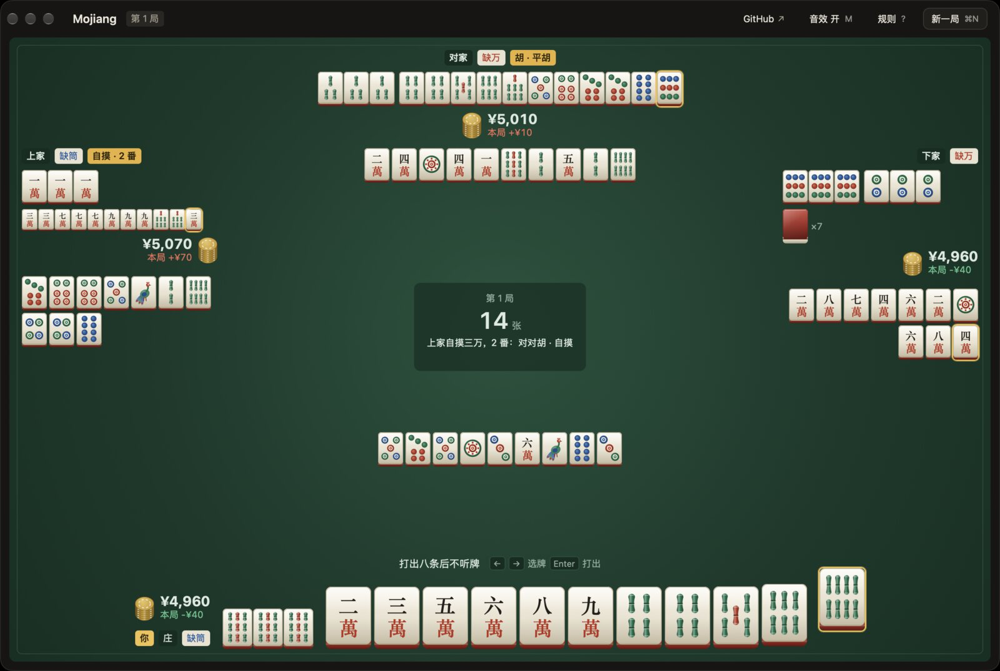
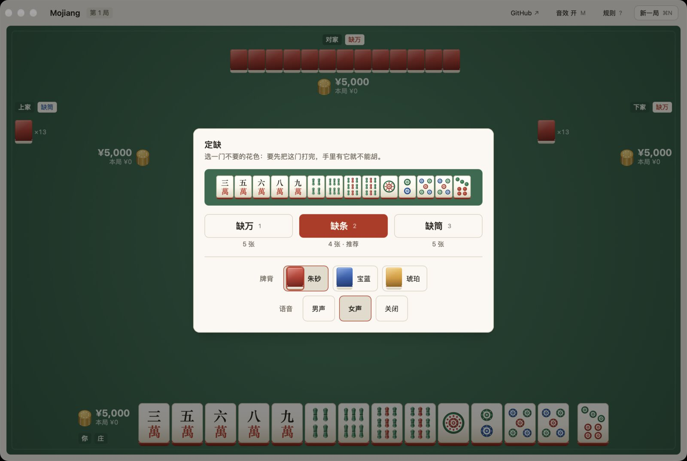
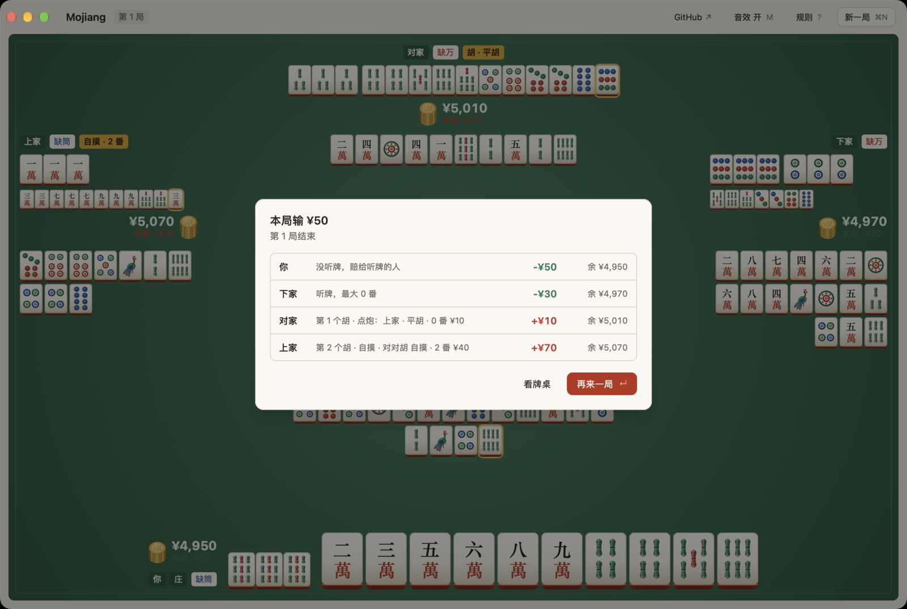

# Mojiang

用 [NSH](https://nsh.dev)（纯 TSX）写的四川麻将“血战到底”：你和三家电脑对战。

**在线玩：** https://huacnlee.github.io/mahjong/



| 开局：选缺门、牌背和语音，再点“开始” | 一局结算 |
|---|---|
|  |  |

iPhone 横屏：


## 安装

macOS（Apple 芯片）/ Linux（x86_64，需要 GTK 4.14+）：

```sh
curl -fsSL https://huacnlee.github.io/mahjong/install.sh | sh
```

Windows（PowerShell）：

```powershell
irm https://huacnlee.github.io/mahjong/install.ps1 | iex
```

脚本会从 [Releases](https://github.com/huacnlee/mahjong/releases) 下载对应安装包，核对 `SHA256SUMS` 后安装。指定版本：`MAHJONG_VERSION=v1.0.0`。

手机：

- **Android**：在 Releases 下载 `mahjong-android.apk` 安装。
- **iOS**：Releases 里有模拟器包 `mahjong-ios-simulator.zip`；装到真机需要开发者签名（见 `.github/workflows/release.yml` 里的 Secrets 说明）。

## 玩法

每人本金 5,000 筹码，底注 10。开局先选缺门（默认是推荐的那门，`1` `2` `3` 切换），也可以选牌背风格（朱砂、宝蓝、琥珀）和语音，然后点“开始”（`Enter`）。点一张牌选中、再点一下打出（或 `←` `→` 选牌、`Enter` 打出）。别人打出你能要的牌时出现 胡 `H` / 杠 `G` / 碰 `P` / 过 `Esc`。`⌘N` 新一局，`?` 规则，`M` 开关音效。手机上横屏玩。

## 特点

- 牌面全部用 Canvas 绘制：象牙色牌面、玉色侧边、高光；牌背三种风格（朱砂、宝蓝、琥珀）。
- 每家面前一摞筹码和余额，刮风下雨当场结算。
- 弹簧动画：摸牌、出牌、碰杠、胡牌摊牌；鼠标划过手牌有连续的波浪。
- 牌桌声音：洗牌、摸牌、出牌的“啪”、碰杠的碰撞声，都是代码合成的。
- 四川话喊牌：碰、杠、自摸、走了，男声、女声两套；三家电脑下家男、对家女、上家男。
- 浅色、深色主题；手机横屏紧凑布局。

## 开发

```sh
nsh run                  # 运行
nsh test                 # 规则与界面测试
nsh run ui/Gallery.tsx   # 查看牌面与控件
nsh test assets/icon-src/icon.test.tsx --target macos && scripts/icon-macos.sh   # 重新生成图标
```

- `game/`：规则、对局状态机、电脑打法（不依赖界面）
- `app/`：牌桌页面、布局档位与状态
- `ui/`：牌面、按钮、对话框、动效与音效
- `DESIGN.md`：设计规范、动效清单与音效清单

## 发布

推送到 `main` 自动发布网页版；打 `v*` tag 自动打包 macOS、Windows、Linux、iOS、Android 并创建 Release。
