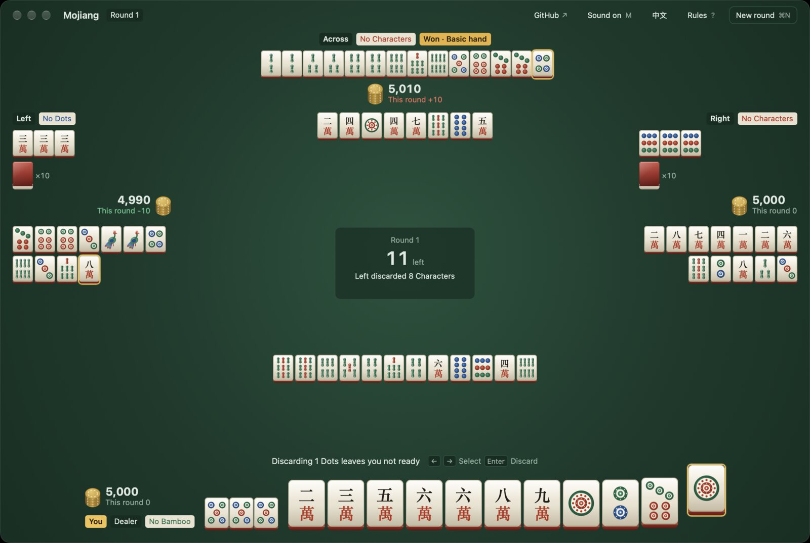
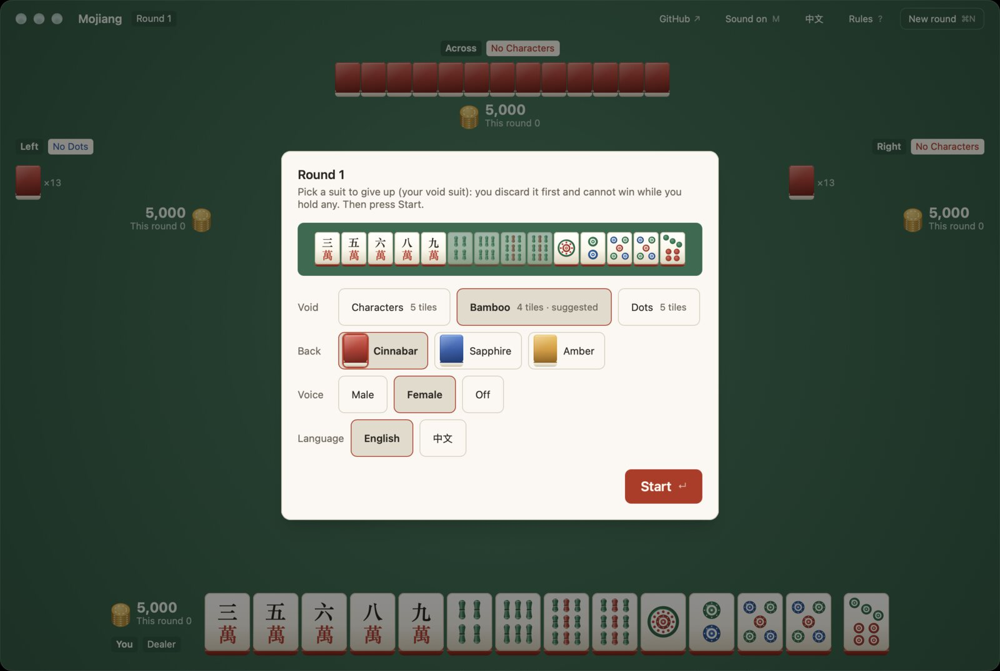
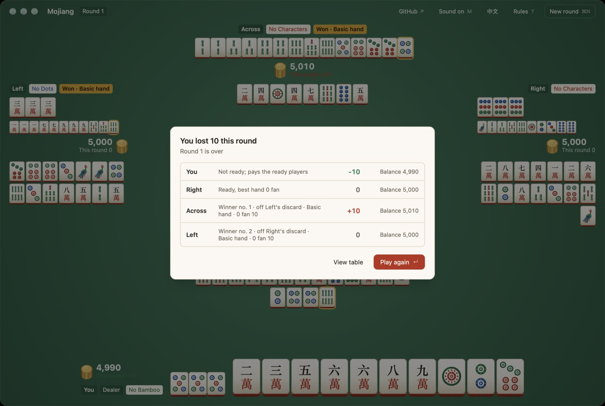
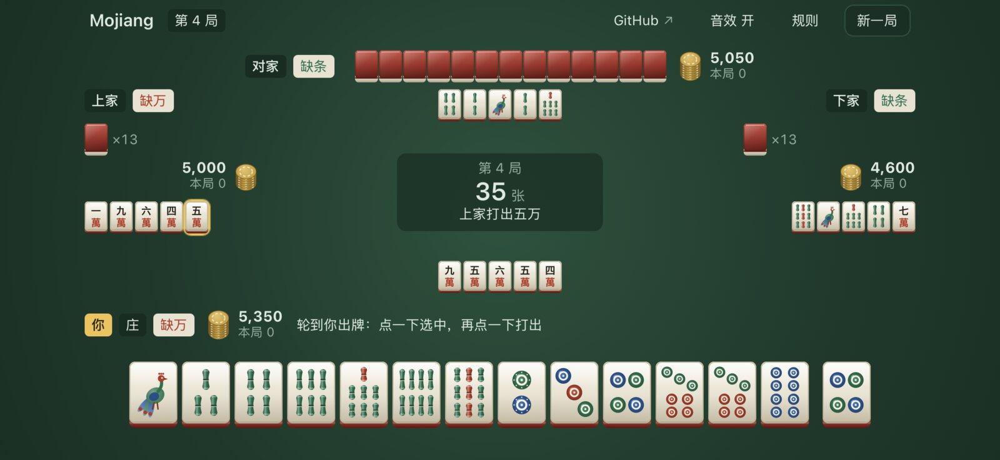

# Mojiang

**English** · [中文](README.zh-CN.md)

Sichuan Mahjong in the "Bloody Battle" style (血战到底, *xuè zhàn dào dǐ*), written in pure TSX with [NSH](https://nsh.dev). You play against three computer players.

**Play online:** https://huacnlee.github.io/mahjong/



| Start: pick your void suit, tile back, voice and language, then press Start | End of a round |
|---|---|
|  |  |

On iPhone, in landscape:



## Install

macOS (Apple silicon) / Linux (x86_64, GTK 4.14+):

```sh
curl -fsSL https://huacnlee.github.io/mahjong/install.sh | sh
```

Windows (PowerShell):

```powershell
irm https://huacnlee.github.io/mahjong/install.ps1 | iex
```

The script downloads the package for your system from [Releases](https://github.com/huacnlee/mahjong/releases), checks it against `SHA256SUMS` and installs it. Pick a version with `MAHJONG_VERSION=v1.1.0`.

Phones:

- **Android**: download `mahjong-android.apk` from Releases and install it.
- **iOS**: Releases has a simulator build, `mahjong-ios-simulator.zip`; a device needs a developer signature (see the Secrets in `.github/workflows/release.yml`).

## How to play

Each player starts with 5,000 chips; the base stake is 10. Each round starts by choosing a void suit, the suit you give up (the suggested one is picked; switch with `1` `2` `3`). You can also choose the tile back (Cinnabar, Sapphire, Amber), the voice and the language. Then press Start (`Enter`).

Tap a tile to select it and tap it again to discard it (or select with `←` `→` and discard with `Enter`). When someone discards a tile you can use, Win `H` / Kong `G` / Pung `P` / Pass `Esc` appear. `⌘N` starts a new round, `?` shows the rules and `M` toggles sound. On phones, play in landscape.

The rules in short: there are no honor tiles, only Characters, Bamboo and Dots. You must play out your void suit before you can win. A round doesn't end at the first win: winners leave and the rest play on until one player is left or the wall runs out.

## Features

- Every tile is drawn on a Canvas: ivory faces, jade sides and highlights; three tile backs (Cinnabar, Sapphire, Amber).
- A chip stack and balance in front of every player; kongs pay out on the spot.
- Spring motion for drawing, discarding, pungs and kongs and the final reveal; a ripple runs across your hand under the pointer.
- Table sounds (shuffling, drawing, the clack of a discard, pungs and kongs), all synthesized in code.
- Calls in Sichuan dialect (pung, kong, self-drawn win, "I'm out") in a male and a female voice.
- Light and dark themes; a compact landscape layout on phones.
- English and Chinese, switched from the title bar; the web version starts in English.
- Desktop auto-update: checks for a new version at launch, downloads it in the background, and "Restart to update" installs it. Phones link to the download page.

## Development

```sh
nsh run                  # run it
nsh test                 # rule and UI tests
nsh run ui/Gallery.tsx   # tiles and controls
nsh test assets/icon-src/icon.test.tsx --target macos && scripts/icon-macos.sh   # regenerate the icon
```

- `game/`: rules, the round's state machine and the computer players (no UI)
- `app/`: the table page, layout breakpoints, state and the updater
- `ui/`: tiles, buttons, dialogs, motion, sound and language
- `locales/app.yml`: English and Chinese strings
- `DESIGN.md`: design rules, motion and sound inventories (in Chinese)

## Releasing

Pushing to `main` deploys the web version. Pushing a `v*` tag builds macOS, Windows, Linux, iOS and Android and creates a Release.

To release, raise `version` in `nsh.json` and push an annotated tag; its message is the release notes shown in the app:

```sh
git tag -a v1.2.0 -m "What changed…" && git push origin v1.2.0
```

The Release includes a signed `latest.json` that installed apps update from. The signing key is `keys/update.secret` (not in git; back it up), stored on GitHub as the `UPDATE_KEY` secret; the public key is `updater.publicKey` in `nsh.json`.
